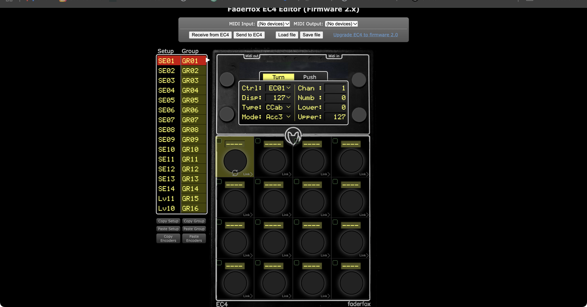
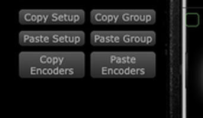

# Faderfox Controller Editor (Web-MIDI)
This project offers browser-based editors for MIDI controllers by [faderfox.de](http://faderfox.de).

> **About this fork** — This repository is a maintained fork of the original
> [faderfox-editor](https://github.com/privatepublic-de/faderfox-editor) by Peter Witzel. It adds
> copy/paste and drag & drop workflows to the EC4 editor (see *New features of this fork* below)
> and includes a native CoreMIDI bridge, so the editor can be run locally on macOS with a
> double-click — no web server or deployment required.

**What's new here:** copy/paste encoders, groups and whole setups — and drag & drop to swap them.

To use this editor you need a Web-MIDI-enabled webbrowser. Currently only Google Chrome (since Version 49 with sysex-support) and [Chromium](https://www.chromium.org/Home) support Web-MIDI.

## EC4 Editor

Editor for the [EC4 Encoder Controller](http://www.faderfox.de/ec4.html). You can find a ready-to-use version under [https://www.privatepublic.de/faderfox-editor/ec4](https://www.privatepublic.de/faderfox-editor/ec4).

## Local EC4 editor on macOS

Connect the EC4 via USB and double-click **`Start EC4 Editor.command`**. The first start installs the local CoreMIDI bridge automatically. Keep the opened Terminal window running while using the editor; close it or press `Ctrl+C` to stop the server. If the bridge is already running (also as a background process on port 8321), the script just opens Chrome at `http://localhost:8321/ec4-v2/`.

### New features of this fork (v2.0b+)

These features are additions to the original editor and only apply to the EC4 (FW 2.x):

- **Copy / paste individual encoders** – check the checkbox in the top-left corner of encoder rows (green row = selected), then use **Copy Encoders** / **Paste Encoders** in the preset toolbar. In the paste dialog, click the target positions; the mapping follows your click order (each field shows its number).
- **Partial copy** – the Copy Encoders dialog has two checkboxes, *Encoder (knob) settings* and *Push button settings* (both checked by default), so you can copy only the rotary or only the push-button part of an encoder.
- **Drag & drop encoder swap** – drag the knob disc of an encoder onto another encoder row of the same group to exchange both encoders completely (all settings, name and push-button settings).
- **Drag & drop group swap** – in the setup/group list on the left, drag a whole group row onto another group of the same setup to exchange both groups (name + all 16 encoders).
- **Drag & drop setup swap** – drag a whole setup row onto another setup to exchange both setups including all 16 groups, names and encoder settings.

All swaps ask for confirmation before changing anything. After editing, use **Send to EC4** to transfer the changes to the device. The toolbar buttons show short hints when you hover over them.

## PC4 editor

Editor for the [PC4 Pot Controller](http://faderfox.de/pc4.html). You can find a ready-to-use version under [https://www.privatepublic.de/faderfox-editor/pc4](https://www.privatepublic.de/faderfox-editor/pc4).

This software was developed in co-operation with faderfox.

## License

MIT — see [LICENSE.txt](LICENSE.txt). Original editor © 2017 Peter Witzel; fork additions © 2026 Sascha Radojkovic.